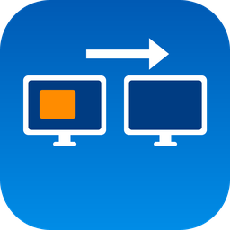

<p align="center">
  
</p>

<h1 align="center">SendToScreen</h1>

<p align="center">
  Move any running app to another monitor straight from the Windows 11 taskbar.<br>
  <strong>~288 KB on disk · ~2–3 MB RAM · pure Win32 — no frameworks, no services, no DLLs.</strong>
</p>

---

## Why I Built This

I have three monitors, one of them a 48″ OLED. OLEDs are gorgeous, but they have a burn-in protection mode that kicks in when the display goes idle — the screen dims, runs pixel-refresh routines, and you're locked out for several minutes. That's fine when you're done for the night, but not when you're in the middle of work or a game and just need to keep going on a different screen.

I wanted a way to **move any running application to another monitor with a single gesture** — no dragging windows across three screens, no fumbling with display settings. Just **Ctrl + right-click** the app's taskbar icon, pick a screen, done.

The other half of the problem is streaming. I use OBS, Stream Deck, chat overlays, and a handful of other tools that each need to land on a specific monitor when they launch. Windows doesn't remember this reliably, and most apps ignore the "last position" hint entirely. So SendToScreen also has **auto-placement rules**: tell it which app goes on which monitor, in what state (maximized, windowed at a specific size, or minimized), and it enforces that every time the app starts.

## Features

### Move Any App Instantly

**Ctrl + right-click** a running app's taskbar button to open the monitor picker. While the menu is open, each monitor shows a large numbered badge so you always know which is which — even after Windows has renumbered your displays.

- Window size and position are preserved (clamped to fit the target monitor)
- Maximized windows stay maximized
- Minimized windows are restored
- The app comes to the front

Plain right-click, Shift+right-click, and Ctrl+left-click keep their normal taskbar behavior.

### Auto-Placement Rules

Right-click the tray icon → **Manage Rules** to open the rules editor. For each app you can set:

| Setting | Options |
|---------|---------|
| **Monitor** | Any connected display, by number |
| **Window state** | Maximized, Windowed (with position and size), or Minimized |
| **Bring to front** | Force the app to the foreground, or send it to the back |

Rules are applied automatically when the app launches and enforced for 10 seconds afterward (in case the app tries to reposition itself). Rules persist in `%LOCALAPPDATA%\SendToScreen\rules.json` and survive reboots and reinstalls.

## Install

Download **`SendToScreen_Setup_v2.0.3.exe`** from the [latest release](https://github.com/jbowensii/SendToScreen/releases/latest) and run it.

- Requires administrator for installation (UAC prompt) — needed to control windows across all integrity levels
- Option to start SendToScreen when you sign in (on by default)
- Lives in the system tray; right-click the tray icon to exit or manage placement rules
- Uninstall from **Settings → Apps**

**Requirements:** Windows 11 with two or more monitors.

## How It Works

Windows 11 offers no API for adding items to a taskbar button's context menu — the taskbar is a XAML surface owned by Explorer. SendToScreen installs a low-level mouse hook, intercepts only the **Ctrl + right-click** gesture over taskbar buttons, identifies the button through UI Automation, and shows its own popup menu. No Explorer injection, no DLLs, no services.

Auto-placement uses a WinEvent hook (`EVENT_OBJECT_SHOW`) to detect new windows. When a window appears whose executable matches a rule, SendToScreen waits 200ms for the app to finish its own layout, moves the window to the target monitor, and polls every 500ms for 10 seconds to enforce the rule against apps that fight back.

## Diagnostics

- `SendToScreen.exe --dump` — logs every taskbar-eligible window with its title, AUMID, exe path, and FileDescription
- `SendToScreen.exe --identify` — shows the screen-number badges for five seconds
- Each gesture is logged to `%LOCALAPPDATA%\SendToScreen.log` (capped at 1 MB, removed on uninstall)

## Build

Requires Visual Studio 2022+ with the C++ workload (CMake and Ninja included), and [Inno Setup 6](https://jrsoftware.org/isdl.php) for the installer.

From an x64 Native Tools prompt:

```
cmake -G Ninja -B build -DCMAKE_BUILD_TYPE=Release
cmake --build build
build\tests.exe
```

`build.ps1` runs the full release pipeline: build, test, sign (SSL.com eSigner), and compile the installer. Pass `-NoSign` to skip code signing.

## License

MIT. See [LICENSE](LICENSE).
